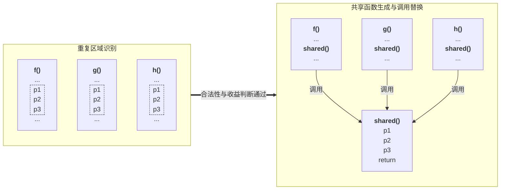
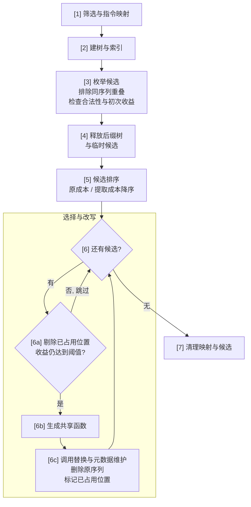
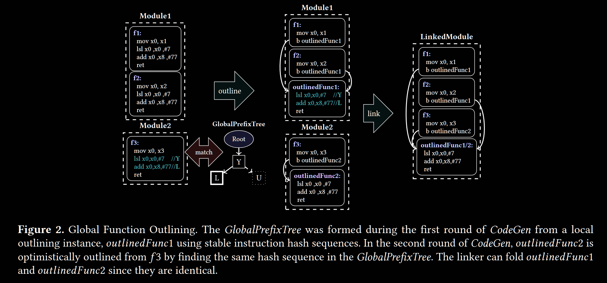
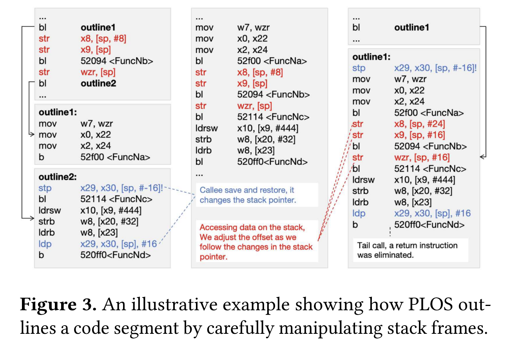
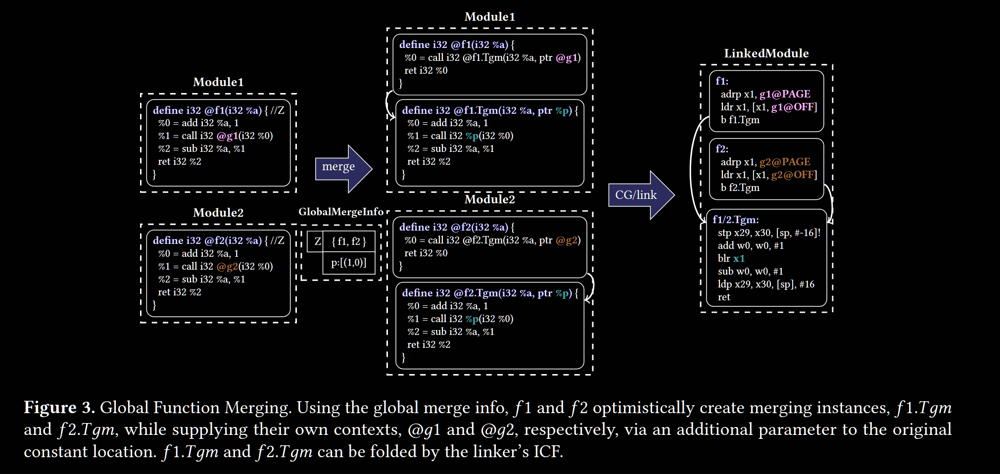

# Code outlining

**Code outlining (代码提取)**: 将重复的代码提取为共享函数, 用调用或跳转替换原序列, 减少代码体积.

> 核心流程: **重复区域识别 → 合法性与收益判断 → 共享函数生成 → 调用或跳转替换**.

重复的 `p1 → p2 → p3` (`p1` 等表示指令, `...` 表示其他代码):



**合法性判断**: 示例互不重叠, 且提取前后语义一致.

**收益判断**: 净收益为正时采用. 序列出现 n 次, 每次占 s 字节; 以下成本均按字节计算.

图中示意值: n = 3, s = 12 B; 共享函数含返回指令 16 B, 每处调用 4 B, 无额外栈帧开销.

```text
原成本 = n × s
    = 3 × 12 = 36 B
提取后成本 = 共享函数体 + 栈帧开销 + 各调用点开销之和
    = 16 + 0 + 3 × 4 = 28 B
净收益 = 原成本 - 提取后成本
    = 36 - 28 = 8 B > 0
```

| 影响因素 | 处理要点 |
| --- | --- |
| 语义保持 | 满足控制流, 调用约定, 异常和元数据约束 |
| 候选重叠 | 选择互不冲突的出现位置 |
| 最终体积 | 计入对齐, 分支距离与链接布局的影响 |
| 运行开销 | 评估新增分支与寄存器保存; 可用运行时信息 (profile) 限制热路径上的 code outlining |

## Code outlining 层次

| 代码表示 | 实现或路线 | 关键处理 |
| --- | --- | --- |
| LLVM IR | IROutliner (已移除) | 识别结构相似区域, 统一输入输出并共享代码 |
| MIR | MachineOutliner | 在寄存器分配后识别重复序列, 计算目标指令与调用成本 |
| 链接前机器代码 | Link-time outlining | 汇集目标文件或编译产物, 处理布局与重定位 |
| 已链接的二进制 | Post-link outlining | 恢复指令与控制流, 重写代码及相关信息 |

## LLVM 中的 code outlining

### IROutliner

[CodeExtractor](https://github.com/llvm/llvm-project/blob/ee8cfbf7c22ba7da178b9bef0308fc3ff3322b5d/llvm/include/llvm/Transforms/Utils/CodeExtractor.h)负责将指定 IR 区域移入新函数并处理输入输出, 不负责发现重复代码.

**[IROutliner 已从 LLVM 24.x 主线移除](https://github.com/llvm/llvm-project/commit/1cf3b70dab75e05516d97ce3d71d7a7495c7fcad)**.

- 原因: 正确性问题, 缺少维护者.
- 同步删除: IRSimilarity 分析, `llvm-sim`.

旧处理链:

| 阶段 | 机制 |
| --- | --- |
| [IRSimilarityIdentifier](https://github.com/llvm/llvm-project/blob/llvmorg-23.1.4/llvm/lib/Analysis/IRSimilarityIdentifier.cpp) | IR 指令映射 → 后缀树匹配 → 结构与操作数对应检查 |
| [IROutliner](https://github.com/llvm/llvm-project/blob/llvmorg-23.1.4/llvm/lib/Transforms/IPO/IROutliner.cpp) | CodeExtractor 提取区域 → 统一参数与输出 → 生成共享函数 |

IR 层可表达输入输出差异; 成本仍需估算最终指令, 参数传递与寄存器压力.

Plus: [HotColdSplitting (冷热代码分离)](https://github.com/llvm/llvm-project/blob/ee8cfbf7c22ba7da178b9bef0308fc3ff3322b5d/llvm/lib/Transforms/IPO/HotColdSplitting.cpp)也使用 CodeExtractor, 将冷区域移入独立函数以改善代码局部性; 不要求重复代码, 也不保证总体积减小.

### MachineOutliner 流程

**MachineOutliner 单轮局部提取**: 图中节点与伪代码小节编号链接到耗时表, 表中编号返回对应伪代码.



[管线入口](https://github.com/llvm/llvm-project/blob/f14f34f217a99d77628d547b1b3ba9fa47fbd06b/llvm/lib/CodeGen/TargetPassConfig.cpp#L1094-L1099): `createMachineOutlinerPass`. 以下为 [MachineOutliner.cpp](https://github.com/llvm/llvm-project/blob/f14f34f217a99d77628d547b1b3ba9fa47fbd06b/llvm/lib/CodeGen/MachineOutliner.cpp)与 [SuffixTree.cpp](https://github.com/llvm/llvm-project/blob/f14f34f217a99d77628d547b1b3ba9fa47fbd06b/llvm/lib/Support/SuffixTree.cpp#L29-L56)的伪代码骨架. 名称沿用源码, `...` 省略参数或细节.

<a id="mo-pass"></a>

**[[总计]](#mo-time-total) 完整 pass**: 模式选择 → 首轮执行 → 可选重跑 → 摘要输出.

```python
MachineOutliner::runOnModule(M):
    # None: 局部匹配; Write: 局部匹配并收集摘要; Read: 匹配已有摘要.
    initializeOutlinerMode(M)
    if not doOutline(M, ...): return false
    # OutlinerReruns 指首轮后的额外轮数, 默认 0.
    # 每轮重新映射; 无变化时提前停止.
    repeat OutlinerReruns times:
        if not doOutline(M, ...): break
    if OutlinerMode == CGDataMode::Write:
        emitOutlinedHashTree(M)
    return true
```

<a id="mo-round"></a>

**单轮流程**: [[1]](#mo-time-1) 映射 → [[2]](#mo-time-2)-[[4]](#mo-time-4) 候选发现 → [[5]](#mo-time-5)-[[6]](#mo-time-6) 选择改写 → [[7]](#mo-time-7) 清理.

```python
MachineOutliner::doOutline(M, ...):
    # [1] 筛选函数与基本块, 将合法指令映射为整数.
    # 分隔符阻止跨越不可提取指令与基本块边界.
    populateMapper(Mapper, M)
    if OutlinerMode == CGDataMode::Read:
        # 匹配全局哈希树, 按全局次数估算收益.
        findGlobalCandidates(Mapper, FunctionList)
    else:
        # [2] → [3] → [4].
        findCandidates(Mapper, FunctionList)
    # [5] → [6].
    OutlinedSomething = outline(M, FunctionList, Mapper, ...)
    # [7] 返回时销毁 FunctionList, Mapper 等局部对象.
    return OutlinedSomething
```

<a id="mo-candidates"></a>

**[[2]](#mo-time-2)-[[4]](#mo-time-4) 候选发现**: 保留至少两处实例且收益达到阈值的候选.

子项: [[2a]](#mo-time-2a), [[2b]](#mo-time-2b), [[2c]](#mo-time-2c), [[3a]](#mo-time-3a).

```python
MachineOutliner::findCandidates(Mapper, FunctionList):
    # [2] 建树与索引, 构造内部依次执行:
    # [2a] 初始化与 extend 建树.
    # [2b] setSuffixIndices 设置路径长度与后缀索引.
    # [2c] 开启 OutlinerLeafDescendants 时, setLeafNodes 收集后代叶范围, 随后收尾.
    SuffixTree ST(Mapper.UnsignedVec, OutlinerLeafDescendants)
    # [3] 构造返回至枚举循环结束.
    for RS in ST:
        # 按起点排序, 再收集互不重叠的位置.
        llvm::sort(RS.StartIndices)
        # 后端支持时, 先用 partitionCandidatesByInputSection 按输入节分组.
        # 其中 [3a] 仅计 TII.getOutliningCandidateInfo: 合法性检查, 调用与栈帧成本.
        # 创建候选描述符, 尚不生成机器函数.
        createOutlinedFunctionIfBeneficial(...)
    # [4] 返回时销毁后缀树与临时候选容器, 保留 FunctionList.
    return
```

<a id="mo-rewrite"></a>

**[[5]](#mo-time-5)-[[6]](#mo-time-6) 选择与改写**: 剔除重叠后重新检查收益. [OutlinedFunction](https://github.com/llvm/llvm-project/blob/f14f34f217a99d77628d547b1b3ba9fa47fbd06b/llvm/include/llvm/CodeGen/MachineOutliner.h)提供按字节计算的成本与收益, 用于排序和阈值判断.

子项: [[6a]](#mo-time-6a), [[6b]](#mo-time-6b), [[6c]](#mo-time-6c).

```python
# [5] outline 入口至排序结束.
MachineOutliner::outline(M, FunctionList, Mapper, ...):
    OutlinedSomething = false
    # 按 getNotOutlinedCost() / getOutliningCost() 降序.
    stable_sort(FunctionList, ...)
    # [6] 排序结束至 outline 返回.
    for OF in FunctionList:
        # [6a] 检查 -1 标记与剩余收益.
        erase_if(OF->Candidates, ...)
        if OF->getBenefit() < OutlinerBenefitThreshold:
            continue
        # 清除提取范围中的链接优化提示.
        TM.clearLinkerOptimizationHints(...)
        # [6b] 复制指令, 汇总入口活跃寄存器; TII.buildOutlinedFrame 构建栈帧.
        # Read/Write 模式下, computeAndPublishHashSequence 在构建栈帧前计算哈希.
        # 仅 Write 发布摘要.
        OF->MF = createOutlinedFunction(...)
        # [6c] 调用替换循环, 含调试位置, 活跃信息与调用点维护.
        for C in OF->Candidates:
            # 插入调用或尾跳转, 处理寄存器保存与恢复.
            TII.insertOutlinedCall(...)
            # 删除原序列.
            MBB.erase(...)
            # 标记整个区间为已占用, 阻止后续候选复用.
            Mapper.UnsignedVec[C.getStartIdx() : C.getEndIdx() + 1] = -1
            OutlinedSomething = true
    return OutlinedSomething
```

## 跨模块 code outlining

**链接时优化 (LTO)** 组织跨模块编译, code outlining 由具体 pass 执行.

- FullLTO: 合并 IR 模块后统一优化与代码生成.
- [ThinLTO](https://clang.llvm.org/docs/ThinLTO.html): 汇总摘要, 按需导入其他模块的函数, 各模块并行优化与代码生成.
- NoLTO: 各模块独立编译, 链接器组合目标文件.

代码生成数据 (CGData) 保存指令哈希树与函数摘要.

| 路线 | 全局信息 | 代价与条件 |
| --- | --- | --- |
| FullLTO + MachineOutliner | 合并模块生成的 MIR | 合并编译的时间与内存; 多轮提取需单独安排 |
| CGData 指导的 MachineOutliner | 跨模块指令哈希树 | 各模块按摘要提取, 由链接器折叠相同副本 |
| Link-time outlining | 各目标文件的机器代码与重定位 | 链接器承担识别, 提取与修补 |

- [An Experience with Code-Size Optimization for Production iOS Mobile Applications](https://dl.acm.org/doi/10.1109/CGO51591.2021.9370306): FullLTO + 多轮 outlining.
- [Efficient Profile-Guided Size Optimization for Native Mobile Applications](https://dl.acm.org/doi/10.1145/3497776.3517764): 两轮机器代码生成, 分别收集全局信息与执行提取; 不重复整轮 IR 优化.

MachineOutliner 使用 CGData 中的指令哈希树, 分为三种模式:

| 模式 | 行为 |
| --- | --- |
| None | 在本模块使用后缀树发现候选 |
| Write | 执行局部提取, 将可生成稳定哈希的已提取实例写入摘要 |
| Read | 匹配全局哈希树; 本模块可仅有一处实例, 收益按摘要中的全局次数估算 |


两轮可以发生在一次构建中, 也可以复用先前构建的摘要. **CGData 记录代码结构, profile 记录执行行为**.

全局前缀树通过稳定指令哈希定位候选.



图源: [Optimistic and Scalable Global Function Merging](https://dl.acm.org/doi/10.1145/3652032.3657575), Figure 2.

**摘要边界**: Read 只能匹配 Write 摘要已覆盖的序列.

CGData 摘要写入目标文件的专用节, 由 LLD Mach-O 或 [llvm-cgdata](https://github.com/llvm/llvm-project/blob/ee8cfbf7c22ba7da178b9bef0308fc3ff3322b5d/llvm/tools/llvm-cgdata/llvm-cgdata.cpp)汇总为索引数据.

[Linker Code Size Optimization for Native Mobile Applications](https://dl.acm.org/doi/10.1145/3578360.3580256)直接在链接器中识别与提取候选; CGData 路线由编译器提取, 链接器汇总摘要并折叠副本.

## MachineOutliner 开销分析

- MachineOutliner 基线: [`f14f34f217a9`](https://github.com/llvm/llvm-project/tree/f14f34f217a99d77628d547b1b3ba9fa47fbd06b).

- 构建: X86, `-Oz -DNDEBUG -mno-red-zone`; FullLTO 链接使用 `--lto-O2 --lto-CGO2`.

  > LLVM 选项:  
  > `-enable-machine-outliner=always`: 显式启用 MachineOutliner; 本次未使用 CGData, 执行局部 `findCandidates`.  
  > `-outliner-leaf-descendants=true`: 收集后缀树内部节点的全部后代叶节点.  
  > `-machine-outliner-reruns=0`: 仅执行首轮, 无额外轮次.

- 统计: 每轮累加所有输入的 CPU 时间; 共测十轮, 各指标独立去掉最大和最小值后取八轮均值.

| 程序范围 | NoLTO, 逐单元编译 | FullLTO, 合并后编译 |
| --- | --- | --- |
| CTMark, 10 个程序 | 632 个翻译单元 | 每个程序一个合并模块 |
| Clang, `f14f34f217a9`, 含 LLVM/Clang 库依赖 | 2,601 个翻译单元 | 最终链接的一个合并模块 |

以下为细分诊断时间, 单位 ms; 括号内以该列的完整 pass CPU 时间为分母. **子项已包含在父阶段时间内**, 不重复相加.

> 计时范围与独立去极值使分项均值不精确加总.

| 流程节点 | 子项 | CTMark NoLTO | CTMark FullLTO | Clang NoLTO | Clang FullLTO |
| --- | --- | ---: | ---: | ---: | ---: |
| <a id="mo-time-1"></a>**[[1]](#mo-round) 指令映射** | | 328.7 (24.2%) | 188.0 (20.7%) | 3,976.9 (14.7%) | 3,916.0 (10.7%) |
| <a id="mo-time-2"></a>**[[2]](#mo-candidates) 建树与索引** | | 168.8 (12.4%) | 75.3 (8.3%) | 3,113.9 (11.5%) | 3,188.5 (8.7%) |
| | <a id="mo-time-2a"></a>[[2a]](#mo-candidates) 初始化与 `extend` | 126.5 (9.3%) | 46.8 (5.2%) | 2,520.5 (9.3%) | 2,055.3 (5.6%) |
| | <a id="mo-time-2b"></a>[[2b]](#mo-candidates) `setSuffixIndices` | 18.1 (1.3%) | 13.9 (1.5%) | 279.3 (1.0%) | 603.9 (1.6%) |
| | <a id="mo-time-2c"></a>[[2c]](#mo-candidates) `setLeafNodes` 及收尾 | 24.0 (1.8%) | 14.6 (1.6%) | 314.4 (1.2%) | 512.5 (1.4%) |
| <a id="mo-time-3"></a>**[[3]](#mo-candidates) 候选枚举与初次分析** | | 136.9 (10.1%) | 140.0 (15.4%) | 3,609.3 (13.3%) | 7,556.6 (20.6%) |
| | <a id="mo-time-3a"></a>[[3a]](#mo-candidates) `getOutliningCandidateInfo` | 100.2 (7.4%) | 101.4 (11.2%) | 3,033.7 (11.2%) | 5,792.4 (15.8%) |
| <a id="mo-time-4"></a>**[[4]](#mo-candidates) 后缀树与临时候选释放** | | 4.7 (0.3%) | 3.3 (0.4%) | 83.4 (0.3%) | 71.1 (0.2%) |
| <a id="mo-time-5"></a>**[[5]](#mo-rewrite) 候选排序** | | 3.5 (0.3%) | 3.5 (0.4%) | 75.3 (0.3%) | 839.6 (2.3%) |
| <a id="mo-time-6"></a>**[[6]](#mo-rewrite) 选择与改写** | | 674.3 (49.7%) | 496.1 (54.6%) | 16,043.2 (59.2%) | 21,116.4 (57.4%) |
| | <a id="mo-time-6a"></a>[[6a]](#mo-rewrite) 重叠与收益检查 | 5.9 (0.4%) | 8.5 (0.9%) | 111.0 (0.4%) | 463.1 (1.3%) |
| | <a id="mo-time-6b"></a>[[6b]](#mo-rewrite) `createOutlinedFunction` | 424.7 (31.3%) | 202.0 (22.2%) | 11,913.1 (44.0%) | 9,693.6 (26.4%) |
| | <a id="mo-time-6c"></a>[[6c]](#mo-rewrite) 调用替换循环 | 206.6 (15.2%) | 261.4 (28.8%) | 3,443.5 (12.7%) | 9,435.3 (25.7%) |
| <a id="mo-time-7"></a>**[[7]](#mo-round) 映射与候选清理** | | 3.6 (0.3%) | 2.3 (0.3%) | 52.3 (0.2%) | 148.0 (0.4%) |
| <a id="mo-time-total"></a>**[[总计]](#mo-pass) 完整 pass** | | 1,356.8 (100%) | 908.5 (100%) | 27,101.9 (100%) | 36,759.3 (100%) |

> [6] 还包含链接优化提示清除, 优化诊断 (remarks) 与循环管理. 初始化和阶段衔接未全部单列.

候选处理量:

| 项目 | CTMark NoLTO | CTMark FullLTO | Clang NoLTO | Clang FullLTO |
| --- | ---: | ---: | ---: | ---: |
| <a id="mo-count-1"></a>[1] 映射符号, 含分隔符 | 489,543 | 438,347 | 5,561,515 | 7,062,461 |
| [3] 枚举的重复序列 | 27,797 | 24,132 | 314,087 | 360,546 |
| [5] 进入排序的 `OutlinedFunction` | 13,242 | 11,697 | 151,278 | 231,435 |
| [6b] 最终生成函数 | 4,322 | 4,266 | 59,415 | 63,210 |
| [6c] 最终替换位置 | 27,391 | 37,534 | 501,855 | 1,136,817 |

## LLVM 优化与探索

以下优化思路源于 [Lightweight Code Outlining for Android Applications](#lightweight-outlining): **降低资源受限设备的构建成本, 增加可选过滤策略**.

### 上游 PR

优化重点: **减少整树遍历, 无效输入与节点分配**. 下表按 PR 提交顺序排列, 编号对应前文流程.

| PR | 考量与改动 | 比较基线 | 实测效果 |
| --- | --- | --- | --- |
| [#232720](https://github.com/llvm/llvm-project/pull/232720) | **省去整树遍历**: [2a] 插入节点时维护路径长度与后缀起点, 删除 [2b] `setSuffixIndices` | `f14f34f217a9` | **CPU 耗时**: [[2] 建树与索引](#mo-time-2) 减少 5.97%-20.10% |
| [#232767](https://github.com/llvm/llvm-project/pull/232767) | **缩短输入**: [1] 跳过单指令区间, 删除开头与连续分隔符; 候选至少包含两条指令 | `f14f34f217a9` | **符号数量**: [[1] 映射符号](#mo-count-1) 减少 16.92%-22.40%<br/>**CPU 耗时**: [[1] 指令映射](#mo-time-1) 减少 3.38%-10.48%; [[2] 建树与索引](#mo-time-2) 减少 6.53%-14.56% |
| [#233123](https://github.com/llvm/llvm-project/pull/233123) | **利用唯一分隔符**: [2a] 跳过其子节点查找; 父路径不足两条指令时省去边界叶节点 | #232720 | **CPU 耗时**: [[2] 建树与索引](#mo-time-2) 减少 13.89%-29.05%<br/>**峰值新增内存**: [[2] 建树与索引](#mo-time-2) 减少 19.11%-59.77% |
| [#233175](https://github.com/llvm/llvm-project/pull/233175) | **用索引替代叶对象**: [2a] 仅存叶边起点, 结合父路径推导后缀起点; [2c] 直接收集后缀索引 | #233123 | **CPU 耗时**: [[2] 建树与索引](#mo-time-2) 减少 7.69%-21.35%<br/>**峰值新增内存**: [[2] 建树与索引](#mo-time-2) 减少 16.17%-70.82% |

> 范围: X86 `-Oz`, CTMark, SPEC2017 C/C++ Rate, Clang-X86, LLD-X86 的 NoLTO / FullLTO.  
> 降幅范围: 不同程序与编译模式下的最小降幅至最大降幅, 均相对各行基线, 不直接相加.  
> 峰值新增内存: 单次调用的驻留内存 (RSS) 峰值减入口值, 每轮取各输入中的最大值.

**依赖关系**: #232720 → #233123 → #233175; #232767 独立精简输入.

**候选顺序**: #232767 改变映射编号与树遍历顺序, 可影响同优先级候选的贪心选择. 实测 Clang 与 LLD 的 `.text` 变化有增有减, 绝对值均小于各自基线的 0.001%.

### 合并效果

**完整 pass CPU 时间减少 3.10%-6.81%**.

> 对照: `f14f34f217a9` → 四个 PR 的[合并实现](https://github.com/LeisureGensoul/llvm-project/tree/23fe5fb5081ffd834e3d3c4c3e289907bfe1ff3e).  

**整体耗时**: 单位 ms; 箭头为基线 → 合并版, 括号为耗时变化.

| 程序 | NoLTO | FullLTO |
| --- | ---: | ---: |
| CTMark | 1,286.1 → 1,245.5 (-3.16%) | 843.2 → 811.9 (-3.72%) |
| Clang | 24,957.7 → 24,183.5 (-3.10%) | 31,670.5 → 29,512.2 (-6.81%) |

**主要阶段占比**: 以各版本完整 pass 为 100%; 子项包含在父阶段内.

| 流程节点 | 子项 | CTMark NoLTO | CTMark FullLTO | Clang NoLTO | Clang FullLTO |
| --- | --- | ---: | ---: | ---: | ---: |
| [[1] 指令映射](#mo-time-1) |  | 23.8% → 23.7% | 20.2% → 19.9% | 14.9% → 13.8% | 10.9% → 11.0% |
| **[[2] 建树与索引](#mo-time-2)** |  | 12.7% → 9.1% | 7.9% → 4.6% | 12.0% → 8.6% | 9.0% → 4.2% |
| [[3] 候选枚举与初次分析](#mo-time-3) |  | 10.3% → 10.7% | 15.2% → 15.7% | 13.7% → 14.2% | 21.1% → 22.1% |
|  | [[3a] 目标分析](#mo-time-3a) | 7.6% → 8.1% | 11.4% → 12.1% | 11.6% → 12.2% | 16.3% → 17.6% |
| [[5] 候选排序](#mo-time-5) |  | 0.3% → 0.3% | 0.4% → 0.4% | 0.3% → 0.3% | 2.5% → 2.8% |
| **[[6] 选择与改写](#mo-time-6)** |  | 49.9% → 53.0% | 55.5% → 58.8% | 58.2% → 62.2% | 56.0% → 59.3% |
|  | [[6b] 函数创建](#mo-time-6b) | 31.2% → 33.4% | 21.9% → 23.7% | 42.7% → 45.8% | 27.0% → 28.9% |
|  | [[6c] 调用替换](#mo-time-6c) | 15.5% → 16.2% | 30.3% → 31.3% | 13.3% → 13.8% | 23.6% → 24.8% |

- **建树收益**: [2] 耗时减少 30.3%-56.7%, 原占完整 pass 约 8%-13%, 对整体降幅的贡献有限.
- **剩余开销**: [6b] 函数创建与 [6c] 调用替换合计仍占约 50%-60%.

> **Notes**: [ART-Specific](#lightweight-outlining)
>
> 后面针对ART, 其 ARM64 定制实现将链接期 code outlining 放在 OAT 布局前, **直接改写机器码**.
>
> 1. **生成与替换**: 选中序列加上 `ret`, 登记为共享代码块 (thunk); 原位置替换为 `bl` 占位指令, 压紧剩余代码, 更新分支, 重定位位置与 StackMap.
> 2. **布局与修补**: 复用 thunk 的布局与写出机制, 确定地址后填入调用位移.
>
> <a id="art-cost-difference"></a>
>
> **开销差异**: 该实现可利用ART相关重写接口快速进行函数生成与调用替换, 优化重点转向后缀树构建与候选处理.
>> 其主要占比为后缀树相关部分, 与LLVM的表现有所差异; \
>> 除此之外, ART中更大规模的指令也会导致更高的后缀树负载.

### 额外的探索

[suffix-tree-repeated-boundaries](https://github.com/LeisureGensoul/llvm-project/tree/suffix-tree-repeated-boundaries): **复用同一个分隔符**.

- 存储: 边界叶的后缀起点集中到父节点, 移出普通子节点表.
- 匹配: 遇到边界显式截断, 不再依赖分隔符的唯一性.
- 取舍: 减少子节点表条目, 增加每个内部节点的边界容器.

[outliner-candidate-filtering-experiments](https://github.com/LeisureGensoul/llvm-project/tree/outliner-candidate-filtering-experiments): 在上述分支上, **提前减少 [3] 的候选分析**.

1. **收益预选**: 按单位成本模型估算成本比, 确定预选顺序.
2. **序列过滤**: 沿后代与反向后缀链接组合查找, 让预选的 `ABC` 抑制包含它的 `XABCY`.
3. **位置过滤**: 移除被已预选实例覆盖且同起点或同终点的位置, 再检查剩余实例的预计收益.

> 取舍: 增加树上筛选成本, 减少后续枚举与分析. 预估成本未覆盖完整的目标指令与调用约束, 会改变最终候选选择.

### Plus: 后缀树探索

[suffix-tree](https://github.com/LeisureGensoul/suffix-tree): 基于LLVM的后缀树进行独立探索.

- 输入: CTMark 指令映射, 通用文本与合成序列.
- 等价性: 比较重复序列长度与出现位置, 覆盖直接叶子节点和全部后代叶节点两种枚举模式.
- 开销: 独立组件的建树时间, 枚举时间与内存占用. 
> (LLVM的后缀树实现随着数据的增长, 其开销急剧增长; 需要考虑相应的轻量化.)
- [优化整理](https://github.com/LeisureGensoul/suffix-tree/blob/main/docs/optimizations.md): 元数据维护, 叶索引, 边界剪枝与后代收集; 进一步探索共享边界存储与叶范围表示.

## Post-link outlining

[Post-Link Outlining for Code Size Reduction](https://dl.acm.org/doi/10.1145/3708493.3712692)提出基于二进制优化器 BOLT 的 PLOS 方案, 尚未纳入[上游 pass 管线](https://github.com/llvm/llvm-project/blob/ee8cfbf7c22ba7da178b9bef0308fc3ff3322b5d/bolt/lib/Rewrite/BinaryPassManager.cpp).

- 筛选: 函数级 profile 识别冷函数.
- 范围: 原函数与已提取函数中的重复序列.

```text
二进制 + profile → 恢复并筛选指令 → 处理栈帧 → 提取与替换 → 重写二进制
```

含调用序列需保持返回地址与栈对齐. 下例新增 16 字节栈帧, 原 `[sp, #8]` 相应改为 `[sp, #24]`.



图源: [Post-Link Outlining for Code Size Reduction](https://dl.acm.org/doi/10.1145/3708493.3712692), Figure 3.

| 处理项 | 要点 |
| --- | --- |
| 应用二进制接口 (ABI) | 按参数与寄存器传递约定判断栈访问, 确定候选边界 |
| 尾调用 | 返回语义与调用约定允许时, 用跳转替代调用后返回 |
| Shrink wrapping | 将寄存器保存与恢复, 栈空间调整限制在需要的路径 |
| 嵌套提取 | 重新处理栈偏移, 尾调用与引用 |

## ART 与 Calibro

[Android Runtime (ART)](https://source.android.com/docs/core/runtime/jit-compiler)组合使用解释执行, 即时编译 JIT 和预先编译 AOT, 可按 profile 选择 AOT 编译的方法.

OAT 文件保存 AOT 编译代码及相关元数据. [Calibro: Compilation-Assisted Linking-Time Binary Code Outlining for Code Size Reduction in Android Applications](https://2025.cgo.org/details/cgo-2025-papers/42/Calibro-Compilation-Assisted-Linking-Time-Binary-Code-Outlining-for-Code-Size-Reduct)通过编译期与链接期协作消除机器代码冗余:

| 部分 | 职责 |
| --- | --- |
| CTO (Compilation-Time Outlining) | 复用 ART 固定指令生成模板中的重复代码 |
| LTBO (Linking-Time Binary Outlining) | 利用编译期收集的信息, 在链接期识别并提取跨方法重复序列 |

<a id="lightweight-outlining"></a>

开销的进一步控制 - [Lightweight Code Outlining for Android Applications](https://dl.acm.org/doi/10.1145/3776753)

> **核心**: 压缩和裁剪后缀树, 基于偏序关系过滤候选, 减少构建开销; 引入热函数过滤与高频 outlined 序列过滤两种 PGO 方式, 缓解运行时性能开销.

> Plus: [Platform.zip](assets/Platform.zip) - ART 实验代码与操作说明 (已加密).

ART 运行时约束 (Android 17 - 合法性):

| 对象 | 提取时需保持的关系 |
| --- | --- |
| [栈映射 (StackMap)](https://android.googlesource.com/platform/art/+/refs/tags/android-security-17.0.0_r2/runtime/oat/stack_map.h) | 原生代码位置 (native PC) 与字节码位置 (Dex PC), 对象引用位置, 内联信息及 Dex 寄存器值的对应 |
| 挂起与异常位置 | 挂起检查, 调用或隐式异常对应的运行时状态 |
| [栈遍历](https://android.googlesource.com/platform/art/+/refs/tags/android-security-17.0.0_r2/runtime/stack.cc) | 按当前方法与原生 PC 查找 StackMap; 保持方法归属, 返回地址与栈帧关系 |
| [异常与去优化](https://android.googlesource.com/platform/art/+/refs/tags/android-security-17.0.0_r2/runtime/thread.cc) | 查找捕获点, 恢复执行所需的虚拟寄存器状态 |
| 分支与引用 | 代码位置变化后的跳转距离, PC 相对访问和重定位 |

## 尺寸优化的方法

| 方法 | 处理方式 |
| --- | --- |
| Code outlining | 将重复的局部代码区域提取为共享函数 |
| ICF (Identical Code Folding) | 折叠满足等价性与安全条件的相同函数或代码节 |
| 函数合并 (Function merging) | 合并等价函数, 或将相似函数的差异参数化后共享函数体 |

ICF 按代码内容与重定位关系判断等价性. [Safe ICF: Pointer Safe and Unwinding Aware Identical Code Folding in Gold](https://research.google/pubs/safe-icf-pointer-safe-and-unwinding-aware-identical-code-folding-in-gold/)限制折叠以保持函数地址与栈展开语义; 地址安全性取决于折叠模式.

### 函数合并

LLVM 的 [MergeFunctions](https://github.com/llvm/llvm-project/blob/ee8cfbf7c22ba7da178b9bef0308fc3ff3322b5d/llvm/lib/Transforms/IPO/MergeFunctions.cpp)在 IR 层比较并合并等价函数.

[Optimistic and Scalable Global Function Merging](https://dl.acm.org/doi/10.1145/3652032.3657575)通过跨模块摘要指导参数化:

1. **识别差异**: `f1` 调用 `g1`, `f2` 调用 `g2`.
2. **参数化**: 调用目标作为参数, 包装函数保留原入口.
3. **共享函数体**: ICF 折叠参数化后的相同副本.



图源: 同文 Figure 3.

LLVM 的 [GlobalMergeFunctions](https://github.com/llvm/llvm-project/blob/ee8cfbf7c22ba7da178b9bef0308fc3ff3322b5d/llvm/lib/CodeGen/GlobalMergeFunctions.cpp):

- 处理链: 稳定函数摘要 → 结构与常量差异检查 → 参数化函数与包装入口.
- 作用范围: 有全局摘要时跨模块, 无外部摘要时限于模块内.
- 基础设施: 与 MachineOutliner 共用 CGData, 摘要与变换各自独立.
- 收益扣减: 包装调用, 参数传递, 间接调用.

## More: 针对 code outlining 的思考

个人视角下, 后续可以关注以下两个方向.

### 1. 考虑更多指令

在可以通过**等价改写或无损衔接**满足上下文约束的情况下, 处理更多的指令.

### 2. 改进候选选择

MachineOutliner 按成本比降序贪心选择, 剔除重叠后仅重算净收益. **固定优先级不保证全局最优**.

一般带权集合打包的全局求优为 NP-hard ([Passing the Limits of Pure Local Search for Weighted k-Set Packing](https://arxiv.org/abs/2202.01248)); 将候选选择按此建模时, 仍需结合具体约束与成本分析复杂度.

在构建预算内, 我倾向**保留贪心框架, 改进选择权重**: 综合净收益与候选冲突, 提高整体收益.