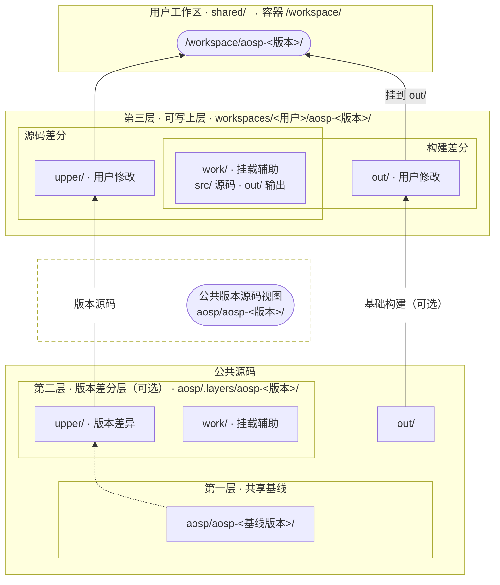

# AOSP 差分存储与工作区



## 路径约定

以下路径相对于 `disk_root` 指定的 SSD 挂载点，Ubuntu 默认使用 `/mnt/aosp`。

```text
aosp/
├── aosp-android-14.0.0_r1/        共享基线，实际存放源码
├── aosp-android-15.0.0_r36/       公共版本源码视图的挂载点
├── aosp-android-16.0.0_r4/        公共版本源码视图的挂载点
├── .layers/
│   ├── aosp-android-15.0.0_r36/   upper/ 存版本差异，work/ 辅助挂载
│   └── aosp-android-16.0.0_r4/    同上
└── .baselines/<基线标识>/         每版一套，含 out/、logs/ 和发布信息

workspaces/<用户>/
├── shared/                        容器的 /workspace/
│   ├── notes/                     用户笔记（示例）
│   └── tools/                     用户工具（示例）
├── accounts/                      用户的 Codex 授权，容器只读
├── codex/                         用户的 Codex 配置和对话
├── ssh/                           用户容器的 SSH 主机密钥（可选）
└── aosp-<版本>/
    ├── upper/
    ├── work/
    ├── out/
    └── view/                      容器的 /workspace/aosp-<版本>/
```

- **公共版本源码视图**。Android 14 直接使用共享基线。Android 15、16 各自叠加版本 `upper/`，在对应挂载点提供只读源码。
- **基础构建**。`aosp/.baselines/<基线标识>/out/` 只读挂到 `aosp/aosp-<版本>/out/`，与 `art/`、`build/` 等源码目录并列。
- **用户工作区**。`shared/` 挂到容器的 `/workspace/`。主机将所选版本的 `view/` 和其中的 `out/` 一起挂入 `shared/aosp-<版本>/`。挂载变化会同步到运行中的容器。

## 写入与输出

- **源码差分**。用户的源码改动写入工作区的 `upper/`。
- **构建输出**。版本和目标匹配时，复用公共 `out/`，工作区的 `out/` 只保存差分。否则，直接在工作区的 `out/` 中构建。
- **挂载辅助**。源码差分使用 `work/src/`，构建差分使用 `work/out/`。

## 共享基线维护

1. 停止工作区，在 `manager/` 下运行 `sudo sh host/public-sources.sh unmount <SSD挂载点>`。
2. 更新共享基线和受影响的版本差分层。
3. 运行 `sudo sh host/public-sources.sh mount <SSD挂载点> all`，再恢复工作区。[工作区生命周期](workspace-lifecycle.md)
