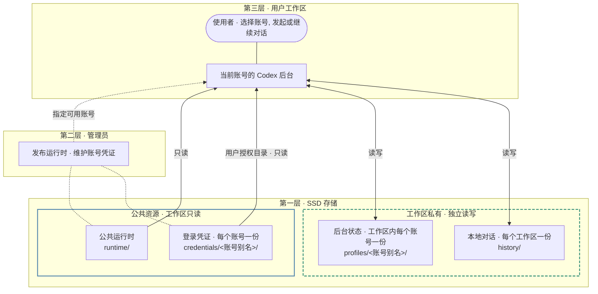

# Codex 统一管理

各工作区共用 Codex 运行时，各自保存本地对话。

公共资源位于 `development/codex/`。`workspaces/<用户>/accounts/` 只包含该用户获准使用的凭证。工作区私有数据位于 `workspaces/<用户>/codex/`。

## 工作区生命周期

- **授权**　用户容器只读挂载 `accounts/`。管理员增删授权后立即生效。
- **切换账号**　启动所选账号的后台，关闭其他账号的后台。重复选择也会清理。
- **重建**　保留账号配置和本地对话。
- **删除版本**　保留用户的账号状态和本地对话。
- **删除用户**　删除该用户的账号状态和本地对话。

## 公共维护

管理员统一维护登录凭证和公共运行时。[安装与更新](../manager/docker/development-runtime.md)
