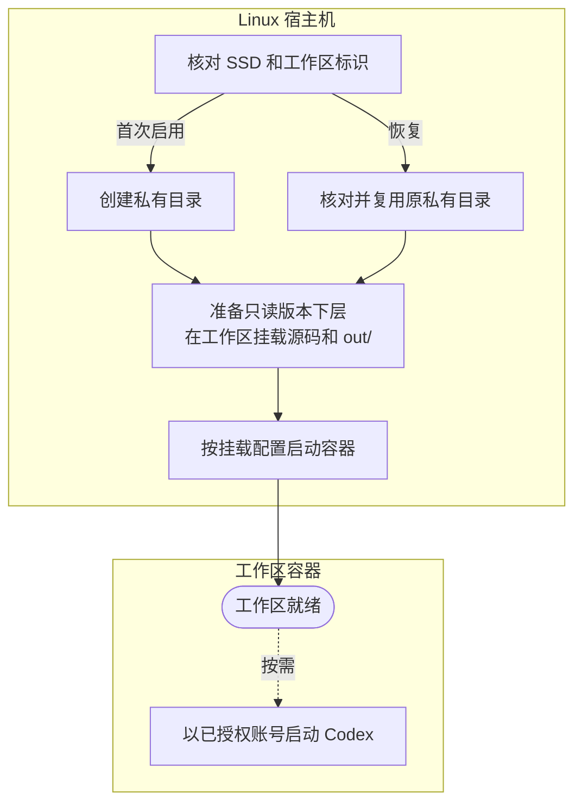

# 工作区运行与生命周期

每个用户有一个工作区和一个容器。主机管理版本挂载，SSD 保存源码改动、构建输出和对话。

## 启动与恢复

## 运行期间的操作

| 操作 | 容器 | 工作区数据 |
| --- | --- | --- |
| 同步版本 `sync` | 保持运行和 SSH 连接 | 按 `versions` 挂载或卸载，保留数据 |
| 停止 `stop` | 停止并保留 | 卸载版本，保留用户数据 |
| 重建 `rebuild` | 按新配置替换 | 重新挂载原数据 |
| 删除已卸载的版本 `delete` | 保留 | 仅删除指定版本的数据 |
| 删除共享文件或目录 | 保留 | 仅删除 `shared/` 下的指定路径 |
| 删除整个用户 | 移除用户容器 | 删除 `workspaces/<用户>/` |

完整命令见[工作区管理](../manager/workspace-management.md)。
