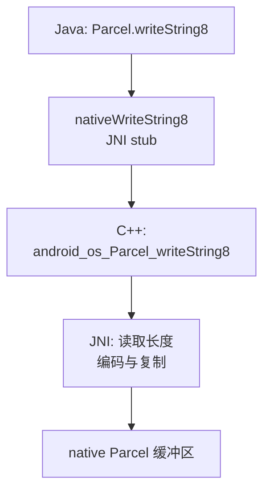
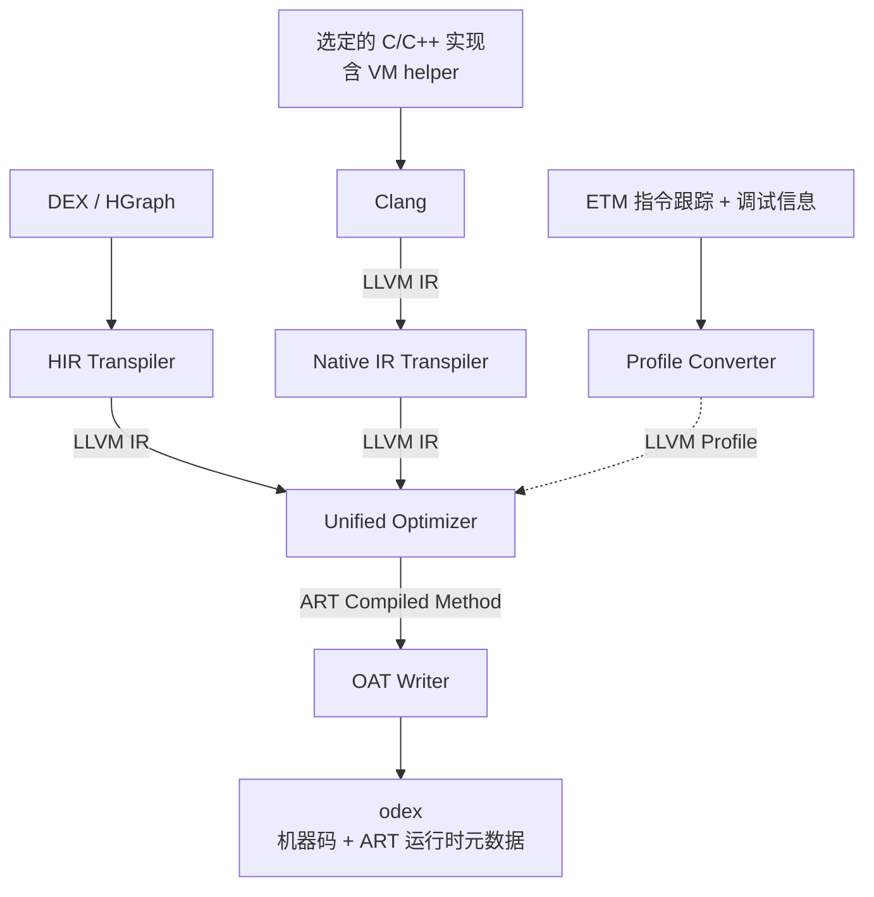
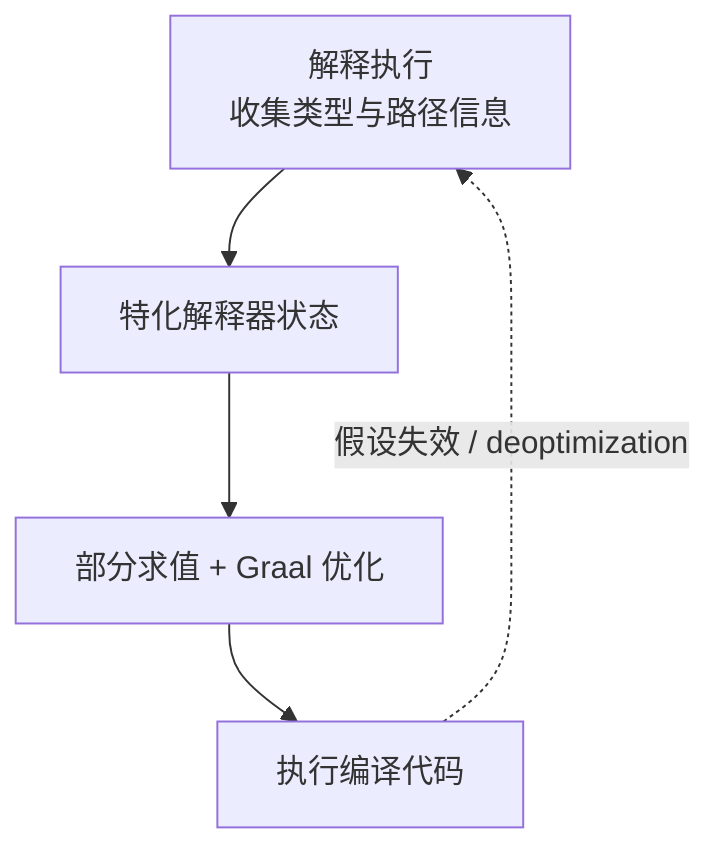

# 跨语言优化

跨语言优化减少调用, 数据转换与运行时适配开销, 并让不同语言的实现共同参与优化.

本文以 Java 与 C/C++ 的交互为例. Java 侧采用托管执行, 由 ART (Android 运行时) 或 JVM (Java 虚拟机) 管理对象与执行状态. 下文将经 JNI 等接口调用的 C/C++ 实现称为 native 代码.

## 边界与开销

FFI 是跨语言函数调用接口, JNI 用于 Java 与 native 交互. 本文讨论同一进程内的调用, 需要对齐参数布局, 数据表示和运行时状态.

| 边界 | 需要处理的内容 | 优化方向 |
| --- | --- | --- |
| 调用 | 参数布局, 寄存器, 跳转与返回 | 批量调用, 简化适配, 内联 |
| 数据 | 字符编码, 对象表示, 拷贝与分配 | 统一表示, 共享缓冲区 |
| 运行时 | 垃圾回收 (GC) 所需的引用信息, 线程状态, 异常与回调 | 保留必要语义, 合并重复处理 |
| 编译 | 两侧函数体与副作用信息不可见 | 统一中间表示 (IR), 特化互操作路径 |

**跨边界内联需要目标实现及其语义对编译器可见**.

## JNI: Parcel 字符串写入

`Parcel.writeString8` 将 Java 字符串写入 native Parcel 缓冲区. 下图只展示写入链路, 不包含 Binder 传输.



[当前 AOSP 实现](https://android.googlesource.com/platform/frameworks/base/+/refs/heads/main/core/jni/android_os_Parcel.cpp)中的关键操作如下. 伪代码省略空值与错误分支.

```cpp
// 读取 UTF-16 长度与 JNI 字符串编码后的字节数.
len = env->GetStringLength(val);
bytes = env->GetStringUTFLength(val);

// 写入长度, 为字符串及结尾零分配空间.
parcel->writeInt32(bytes);
data = parcel->writeInplace(bytes + 1);

// 转换并复制字符串.
env->GetStringUTFRegion(val, 0, len, data);
data[bytes] = 0;
```

### 调用适配

JNI stub 是衔接两侧调用约定的适配代码, 由 [`ArtQuickJniCompileMethod` / `ArtJniCompileMethodInternal`](https://android.googlesource.com/platform/art/+/refs/heads/main/compiler/jni/quick/jni_compiler.cc)生成. 调用成本可沿以下环节分析:

| 位置 | 处理与原因 |
| --- | --- |
| 调用入口 | 按 native ABI (二进制接口约定) 布置参数与栈帧, 将对象参数表示为 JNI 引用 |
| 线程状态 | 普通 JNI 切换到 native 状态, 让 GC 无需等待其中的纯 native 执行; 访问 Java 堆时重新进入受管访问协议 |
| 读取字符串 | 解码 `jstring` 引用, 读取字符数并计算编码后的字节数 |
| 写入缓冲区 | 为长度与字符串申请空间, 按接口要求编码并复制; 成本随字符串内容与长度变化 |
| 调用返回 | 恢复栈帧与必要的线程状态, 清理本次调用的局部引用, 检查待处理异常 |

`jstring` 是由运行时管理的引用, 对象移动后仍能定位字符串. [`GetStringLength`](https://android.googlesource.com/platform/art/+/main/runtime/jni/jni_internal.cc)通过 `ScopedObjectAccess` 和引用解码读取 ART 的 `String` 长度, 属于 **native 侧的运行时访问**.

当前 `nativeWriteString8` 使用 `@FastNative`, 保持 runnable 状态并在返回时处理挂起请求. 它省去通常的状态切换, 字符串访问与编码复制仍需执行.

## 优化路线

| 方向 | 改变什么 | 主要条件 |
| --- | --- | --- |
| [降低调用成本](#降低调用成本) | 减少调用次数或单次适配工作 | 可调整接口粒度, 或满足快速路径约束 |
| [联合编译](#联合编译) | 让两侧实现共同参与内联与计算优化 | 函数体可见, 数据与运行时语义对齐 |
| [解释器特化](#解释器特化) | 按已知程序化简解释器, 消除取指与分派 | 解释器代码可分析, 程序或部分输入已知 |

三条路线可以组合. 解释器特化若覆盖[互操作路径](#互操作路径的特化), 也能让其中的分派与适配逻辑共同参与优化.

## 降低调用成本

用批量接口一次处理整个数组, 可以减少跨语言调用次数. JNI 快速路径则减少每次调用的适配工作.

### JNI 快速路径

ART 针对短 native 方法提供两种优化. [JNI tips](https://developer.android.com/ndk/guides/jni-tips)说明了它们的接口与约束.

| 方式 | 保留的接口 | 主要变化 |
| --- | --- | --- |
| 普通 JNI | `JNIEnv*`, 接收者或类引用, 对象参数 | 正常线程状态切换与引用管理 |
| `@FastNative` | 保留 JNI 接口, 可接收对象 | 省去通常的 native 状态切换 |
| `@CriticalNative` | 静态方法, 参数与返回值不含对象 | 不传 `JNIEnv*` 和 `jclass` |

两种快速路径均要求方法短且不长时间阻塞, 否则可能阻碍 GC. 它们在 Android 14 成为经过 CTS 测试的公开 API. `writeString8` 接收 `String`, 不适用 `@CriticalNative`.

### Java FFM

[Foreign Function & Memory API](https://docs.oracle.com/en/java/javase/27/core/foreign-function-and-memory-api.html)在 [JDK 22 正式加入](https://docs.oracle.com/en/java/javase/22/docs/api/java.base/java/lang/foreign/package-summary.html), 通过 `java.lang.foreign` 提供:

- `Linker`: 建立 Java 调用 native 的 downcall, 以及 native 回调 Java 的 upcall.
- `MemorySegment`: 描述内存区域及访问范围.
- `Arena`: 管理 native 内存的生命周期.

[`Linker.Option.critical(allowHeapAccess)`](https://docs.oracle.com/en/java/javase/27/docs/api/java.base/java/lang/foreign/Linker.Option.html)面向所有执行路径都极短且不回调 Java 的函数. 它向运行时提供简化调用适配的提示:

- `false`: 地址参数使用 native 内存段.
- `true`: 也允许传入堆内存段, 以临时 native 地址访问底层存储. 地址只在本次调用中有效.

与 ART 快速 JNI 类似, 这种方式通过限制调用行为减少适配成本. FFM 的堆内存访问选项与 `@CriticalNative` 的纯基本类型接口各有适用范围.

FFM 减少手写 JNI 胶水代码, 外部函数仍按 native ABI 调用.

## 联合编译

将两侧实现放入同一 IR, 让编译器同时分析调用与函数内部的运算.

### IR 与优化分层

IR 是编译器分析与变换程序的表示. HGraph 与 LLVM IR 都使用静态单赋值 (SSA), 即每个值名只定义一次, 便于跟踪数据依赖.

| 层级 | 主要信息 | 典型处理 |
| --- | --- | --- |
| 语言 IR, 如 ART HGraph | 对象类型, 字段, 方法调用, 异常 | 去虚拟化, 内联, 空值与边界检查消除 |
| LLVM IR | SSA 值, 控制流, 显式内存操作 | 常量传播, 别名分析, 循环优化, 向量化 |
| 机器 IR | 寄存器, 指令约束, 调用约定 | 指令选择, 调度, 寄存器分配 |

IR 的分层随编译器而异, 常量折叠等优化可出现在多个层级. 将高层操作转为更低层操作的过程称为 lowering.

#### ART 现有流程

ART 的 HGraph 已承担中端优化. [`OptimizingCompiler::RunOptimizations`](https://android.googlesource.com/platform/art/+/refs/heads/main/compiler/optimizing/optimizing_compiler.cc)包含内联, GVN, LICM, 边界检查消除, 循环优化和读写消除.

```text
DEX 字节码
  → HGraphBuilder::BuildGraph
  → OptimizingCompiler::RunOptimizations
      通用与语言相关优化
      → RunArchOptimizations
  → 代码生成
  → 机器码 + StackMap 等运行时信息
```

`RunArchOptimizations` 负责 HGraph 上的目标架构相关变换.

引入 LLVM 的价值在于 **复用优化基础设施, 接入 native IR, 扩大联合优化范围**.

### 语义与运行时

转换 IR 需保留原语言语义. 以 [ART](https://source.android.com/docs/core/runtime) 为例, 编译器还需生成类加载, 异常与 GC 所需的调用和元数据.

| 对象 | 必须保留的内容 |
| --- | --- |
| 基本语义 | 整数溢出, 浮点行为, 空值检查, 数组边界与异常顺序 |
| 对象与 GC | 对象布局, 引用表示, 活跃引用, 对象移动后的引用更新, 读写屏障 |
| 调用与栈 | 托管 ABI, 栈帧布局, 栈遍历, native/managed 状态转换 |
| 去优化 | 对应代码位置的逻辑帧, 局部变量和内联调用状态 |
| 并发 | `volatile`, monitor 和 Java 内存模型要求 |

例如, Java 整数加法允许回绕. 转为 LLVM `add` 时, 不能无依据添加 `nsw`; 优化器会据此假定有符号溢出不发生. 见 [LLVM Language Reference](https://llvm.org/docs/LangRef.html).

#### GC 与 StackMap

以移动 GC 为例, 编译器记录 safepoint (安全点) 处的活跃引用位置. GC 移动对象后据此更新引用, 后续代码使用更新后的值.

LLVM 可用 [`gc.statepoint` / `gc.relocate`](https://llvm.org/docs/Statepoints.html)在 IR 中表达可能发生 GC 的调用与移动后的引用. [`llvm.experimental.stackmap`](https://llvm.org/docs/StackMaps.html)可记录指定程序点的值位置.

ART 的 [`StackMap` / `CodeInfo`](https://android.googlesource.com/platform/art/+/refs/heads/main/runtime/oat/stack_map.h)关联机器码与 DEX 字节码中的位置, 并记录引用位置, 内联帧与 DEX 寄存器状态. 后端需按 ART 要求生成这些元数据.

### 内联与 Intrinsic

**内联**展开可见的函数体, 让调用者与被调用者一起参与优化.

以下示例按 32 位无符号整数回绕, `src` 与 `dst` 指向有效且不重叠的区间. `adjust` 只做整数运算, 两侧内存表示与访问方式已对齐.

```text
// native 辅助函数.
adjust(x, k):
    return x * k + 1

// 函数体独立编译时, 循环保留跨语言调用.
for i in [0, n):
    dst[i] = native_call(adjust, src[i], 1)

// 联合 IR 中展开 adjust, 传播 k = 1 并消去乘法.
for i in [0, n):
    dst[i] = src[i] + 1
```

调用与乘法消除后, 循环只剩连续加载, 加法与存储, 可进一步分析依赖并评估向量化.

LLVM 的 [`inline` / `instcombine`](https://llvm.org/docs/Passes.html)执行内联与指令化简, [Loop Vectorizer](https://llvm.org/docs/Vectorizers.html)分析循环向量化. 优化选择取决于合法性, 代码增长与目标架构成本.

**Intrinsic** 为已知操作提供专门实现. 对 Java 或 native 方法, 编译器可直接替换为以下形式:

| 实现形式 | 优化范围 |
| --- | --- |
| 专门 IR 节点或 IR 序列 | 参与后续分析, 化简和代码生成 |
| 直接机器指令 | 在后端实现目标架构能力 |
| runtime stub 或库调用 | 复用专门实现, 保留调用 |

ART 通过 [`IntrinsicVisitor`](https://android.googlesource.com/platform/art/+/refs/heads/main/compiler/optimizing/intrinsics.h)等机制处理 intrinsic, 按操作与目标架构选择实现, 按需保留慢路径.

### ART 接入 LLVM

Android-LLVM 与 Ocompiler 都将 HGraph 转换为 LLVM IR, 复用 LLVM 的优化与代码生成.

#### Android-LLVM

Android-LLVM 侧重迭代优化. [原型仓库](https://github.com/paschalis-mpeis/android-llvm)基于 Android 10, 需要配套修改 ART 和 linker.

[Developer and User-Transparent Compiler Optimization for Interactive Applications](https://doi.org/10.1145/3453483.3454043) (PLDI 2021)采用 **捕获输入 → 离线重放 → 搜索优化配置**. 对部分数学库方法, 后端以 intrinsic 或等价 LLVM IR 替换 JNI 调用, 让这些操作参与后续优化.

[论文 §5.1](https://www.pure.ed.ac.uk/ws/files/214205579/Developer_and_User_Transparent_MPEIS_DOA06042021_AFV.pdf)报告, 搜索后的结果相对 Android 编译器平均加速 1.44×, 相对 LLVM `-O3`平均加速 1.35×. 测量覆盖 12 个基准及 9 个应用中的选定代码区域.

#### Ocompiler (OPPO 繁星编译器)

Ocompiler 用于 ART 的提前编译 (AOT), 支持 **Java/native 联合优化与机器指令级 PGO**. PGO 利用执行路径, 分支频率等运行时信息 (profile) 指导优化. [ODC25 官方演讲, 1:26:40](https://ocs-cn-south1.heytapcs.com/odc/odc25_once/videos/liuchangjishu_mini.mp4#t=5200)展示了 HIR, native IR 与 profile 的合流结构.



- **语义对齐**: 两路 IR 对齐数据布局, 调用约定与 JNI 引用访问. 生成 ART 所需的 StackMap 和异常信息.
- **联合优化**: 纳入选定的 native 实现与 VM helper (运行时辅助函数), 通过内联继续简化读写与循环.
- **PGO**: ETM 记录结合二进制调试信息转换为 profile, 用于分支与代码布局优化.

应用 DEX 可直接编译; 应用 native 库的融合优化需要提供 LLVM IR 并完成定制接入. 其余 native 调用保留 JNI. 见 [ODC25 应用接入说明, 1:30:50](https://ocs-cn-south1.heytapcs.com/odc/odc25_once/videos/liuchangjishu_mini.mp4#t=5450).

原始记录中的应用包括 ArrayMap 二分查找和 `String.indexOf`的 C/C++ 替换实现.

> 早期交流记录: 编译耗时约为原路径的 10 倍, ArrayMap 基础操作提速约 60%. 未附版本与统计口径, 两项数值保留为历史记录.

### JVM 实现参照

<a id="llvm4jni"></a>

#### LLVM4JNI

[fastFFI](https://github.com/alibaba/fastFFI)中的 LLVM4JNI 将可支持的 LLVM bitcode 转换为 Java bytecode. 转换后的实现可与 Java 调用者共同参与 JVM 优化. 生成代码依赖 LLVM4JNI runtime, 用来衔接 native 内存等操作.

```text
native 函数 → LLVM bitcode → Java bytecode → JVM 优化
```

#### Falcon

[Falcon](https://docs.azul.com/prime/Falcon-Compiler)是 Azul Prime 基于 LLVM 的即时编译器 (JIT). 它以 Java bytecode 为输入, 在运行时根据 profile 编译热点方法.

Falcon 在 LLVM IR 中保留 Java 高层语义, **衔接语言相关优化与通用优化**. [FALCON: AN OPTIMIZING JAVA JIT](https://llvm.org/devmtg/2017-10/slides/Reames-FalconKeynote.pdf) (2017)介绍了相关实现:

| 层次 | 处理 |
| --- | --- |
| Java 语义 | 用 attributes, metadata 与 IR 抽象函数保留类型和对象操作, 支持去虚拟化与对象消除 |
| LLVM IR | lowering 抽象操作, 暴露底层实现, 继续进行通用优化 |
| 机器码与运行时 | 实现隐式空值检查, 衔接 GC, 去优化与混合栈遍历 |

## 解释器特化

解释器根据指令或语法节点选择并执行操作, 这个选择过程称为分派. 它所实现的语言称为 guest 语言, 用这种语言编写的程序称为 guest 程序.

部分求值 (Partial Evaluation, PE)利用已知输入化简程序. 固定 guest 程序后, 可以将通用解释器化简为针对该程序的专门代码, 消去取指与分派等开销.

### 从特化到编译

用一个整数解释器执行 `ADD 2 → MUL 3 → RET`. guest 程序固定, 输入 `x` 在运行时提供:

```python
# 固定的 guest 字节码.
program = (("ADD", 2), ("MUL", 3), ("RET", 0))

# 通用解释器, x 为整数.
def interpret(code, x):
    pc = 0
    while True:
        op, k = code[pc]
        if op == "ADD":
            x += k
        elif op == "MUL":
            x *= k
        elif op == "RET":
            return x
        pc += 1

# 固定 program 后的特化结果.
def specialized(x):
    return (x + 2) * 3
```

这里 `pc`, opcode 和立即数都能提前确定, 取指与分派被消除, 对 `x` 的计算仍在运行时执行. guest 程序若有数据相关的分支或循环, 特化结果也需保留它们.

若 `P` 为解释器, `S` 为固定程序, `D` 为动态输入, [Futamura 第一投影](https://fi.ftmr.info/PE-Museum/PE-Original-English1971.pdf)可写为:

> P' = PE(P, S), 且 P'(D) = P(S, D).

本例中, `interpret(program, 4)` 与 `specialized(4)` 均得到 `18`. 生成代码的效率还取决于残留操作与后续优化.

<a id="truffle"></a>

### Truffle

Truffle 用语言解释器表达 guest 语义, Graal 编译器根据已知程序结构和运行时反馈生成优化代码.



**固定程序与运行时假设承担不同职责**. guest 程序决定执行哪些操作; 观察到的类型与调用目标用于选择更专门的实现. Truffle 的 [`@Specialization`](https://www.graalvm.org/truffle/javadoc/com/oracle/truffle/api/dsl/Specialization.html)可用类型与条件检查 (guard), 以及可失效的 `Assumption` 表达适用范围.

例如, 节点同时支持整数相加与字符串拼接, 但只安装了整数特化. 首次遇到字符串时, 可通过 [`transferToInterpreterAndInvalidate`](https://www.graalvm.org/truffle/javadoc/com/oracle/truffle/api/CompilerDirectives.html)返回解释器, 失效旧代码并补充特化. 去优化利用保存的执行位置与帧状态继续执行, 后续再按新状态编译.

[Practical Partial Evaluation for High-Performance Dynamic Language Runtimes](https://chrisseaton.com/truffleruby/pldi17-truffle/pldi17-truffle.pdf) (PLDI 2017)展示了该机制. 下表为论文所测语言与基准, 加速比为基线耗时 / Truffle 耗时.

| Guest 语言 | 论文基线 | 加速比 |
| --- | --- | ---: |
| JavaScript | V8 | 0.83× |
| Ruby | JRuby | 3.8× |
| R | GNU R | 5.0× |

0.83× 表示这组 JavaScript 测试慢于基线. 三组结果反映当时各语言实现的表现, 不比较今天的语言运行时.

#### 互操作路径的特化

Truffle 语言通过互操作协议交换值与调用, 让跨语言边界上的适配逻辑参与优化. [Cross-Language Interoperability in a Multi-Language Runtime](https://doi.org/10.1145/3201898)将对象访问与调用表示为可特化的消息. 以普通对象的字段读取为例:

```text
通用跨语言字段访问
  → PE 利用稳定的类型, 布局与属性名
  → 展开对应语言的读取实现
  → 生成字段访问与必要的运行时检查
```

编译代码用 guard 检查特化条件; 接收者频繁变化时, 会保留更多分派与转换.

[`@TruffleBoundary`](https://www.graalvm.org/truffle/javadoc/com/oracle/truffle/api/CompilerDirectives.TruffleBoundary.html)阻止 PE 展开方法体. `allowInlining = true` 允许后续内联阶段考虑该调用.

#### 解释器形式与编译成本

Truffle 支持抽象语法树 (AST) 与字节码两种解释器形式. [Bytecode DSL](https://www.graalvm.org/truffle/javadoc/com/oracle/truffle/api/bytecode/package-summary.html)自 24.2 起提供字节码解释器的生成与运行支持. 语言实现者定义操作及其特化, [`@GenerateBytecode`](https://www.graalvm.org/truffle/javadoc/com/oracle/truffle/api/bytecode/GenerateBytecode.html)生成字节码编码, 解释器与构建接口. guest 编译仍由 PE 完成.

按每个字节码位置展开解释器时, 相同 opcode 的公共逻辑会被反复分析. [Partial-Evaluation Templates: Accelerating Partial Evaluation with Pre-compiled Templates](https://research.jku.at/en/publications/partial-evaluation-templates-accelerating-partial-evaluation-with/) (CGO 2026)将这部分工作预先整理为参数化 IR 模板:

```text
提前处理: opcode 实现 → 参数化 IR 模板
运行时编译: 绑定静态输入 → 化简模板 → 内联到当前编译图
```

动态操作数保留为图中的值, 公共转换过程得到复用. 论文在 GraalWasm 中测得 PE 时间最多降低 36%, 预热时间最多降低 17%, 峰值性能未受影响.

[GraalVM 25.4](https://www.graalvm.org/release-notes/25.4/)使用 Graal IR 调用点频率决定 guest 内联, 替代运行时直接调用计数. 语言实现注入的分支概率会影响热度估计.

#### GraalVM 执行层

| 组件 | 职责 |
| --- | --- |
| Graal compiler | 优化 IR 并生成机器码 |
| Truffle | 表达语言语义, 支持解释器特化 |
| Polyglot API | 提供宿主侧传值与调用接口 |
| Native Image / SubstrateVM | AOT 编译 Java 应用及其运行时支持 |
| [Sulong](https://www.graalvm.org/latest/reference-manual/llvm/) | 以 LLVM bitcode 为输入, 通过 Truffle/Graal 执行与优化 |

[Native Image 的 LLVM 后端](https://github.com/oracle/graal/blob/master/substratevm/src/com.oracle.svm.core.graal.llvm/src/com/oracle/svm/core/graal/llvm/LLVMBackend.md)使用 LLVM 优化并生成机器码.

#### AOT 与 guest 编译

将 Truffle 解释器构建为 native image, 提前编译的是解释器及其运行时. guest 程序仍由[嵌入式语言运行时](https://www.graalvm.org/latest/reference-manual/embed-languages/)解释, 并在支持的配置中进行 JIT.

<a id="weval"></a>

### Weval

[Partial Evaluation, Whole-Program Compilation](https://doi.org/10.1145/3729259) (PLDI 2025)将编译为 WebAssembly (Wasm) 的 C/C++ 解释器与已知 guest 字节码一起特化. 实现已迁入 [Bytecode Alliance](https://github.com/bytecodealliance/weval).

```text
解释器编译为 Wasm + guest 字节码
  → Wizer 初始化快照
  → Weval 按上下文特化控制流
  → 含专门函数的 Wasm 模块
  → Wasm 引擎执行
```

普通常量传播在解释器循环头合并不同的 `pc` 值, opcode 因而难以保持为常量. Weval 利用注解区分特化上下文, 按字节码位置分别分析, 同时保留 guest 程序的分支与循环.

接入需要添加注解和适配; 输出为 Wasm, 机器码生成由 Wasm 引擎负责. guest AOT 编译无需运行时 profile, 仍可保留动态类型判断和 inline cache.

[论文实验](https://www.c1f.net/pubs/pldi2025_weval.pdf)报告:

| 对象 | 基线 | 优化配置 | 加速比 |
| --- | --- | --- | ---: |
| SpiderMonkey / Octane | Wasm 上的 `Interp + ICs` | `wevaled + state` | 2.17× |
| PUC-Rio Lua | Wasm 上的解释器 | Weval AOT | 1.84× |

SpiderMonkey 的 2.17× 同时包含分派消除与解释器状态优化. 两项结果均相对表中的 Wasm 解释器基线.

### 两种特化方式

| 比较项 | Truffle 常见 JIT 路线 | Weval 论文路线 |
| --- | --- | --- |
| 解释器 | 按 Truffle API 实现, 支持 AST 与 Bytecode DSL | 适配既有 C/C++ 解释器 |
| 静态信息 | guest 程序结构, 特化状态与运行时反馈 | 构建时已知的 guest 字节码与快照 |
| 输出与执行 | guest 机器码, 支持去优化与重新编译 | 专门 Wasm 函数, 交给 Wasm 引擎执行 |
| 主要成本 | PE 编译时间, 预热与重复编译 | 构建时特化, 产物体积与残留动态操作 |

选择取决于 guest 程序何时可知, 以及是否需要根据执行反馈继续特化.

后续可探索 AOT 特化与 profile 的结合: 提前消除稳定的解释开销, 再根据执行反馈优化动态路径.

## 收益与取舍

先区分耗时来自调用适配, 实际计算还是解释器分派, 再选择优化路线.

局部耗时占比越小, 同样的加速对整体性能的改善越有限. 若目标部分占原运行时间的 `p`, 局部加速比为 `s`, 其他部分不变:

> 整体加速比 = 1 / (1 - p + p / s).

> 示例: 原总耗时 10 s, 其中目标部分为 2 s. 若将目标部分缩短为 1 s, 总耗时为 8 + 1 = 9 s, 整体加速比为 10 / 9 ≈ 1.11.

评估需同时覆盖 **边界成本, 核心计算, 编译与预热成本**:

- **调用粒度**: 批量调用减少入口次数, 内部逐元素互操作仍需单独计量.
- **数据表示**: 比较复制后连续计算与共享访问的总成本.
- **比较口径**: 固定输入, 计算和运行时配置. 初始化, 预热和稳态分别统计.
- **收益归因**: 部署变化与编译优化分别评估. 结合编译结果与互操作耗时判断内联效果.
- **编译成本**: 判断后续执行节省的时间能否摊薄新增的编译与预热开销.
