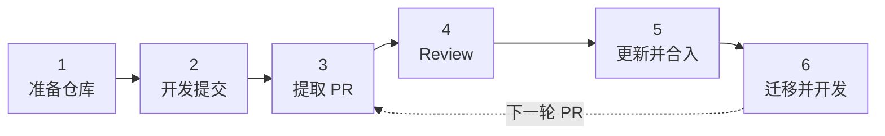
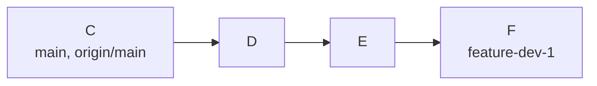
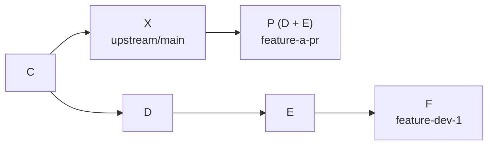
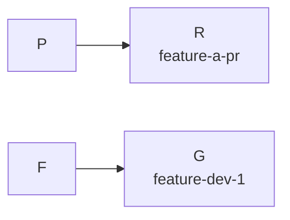
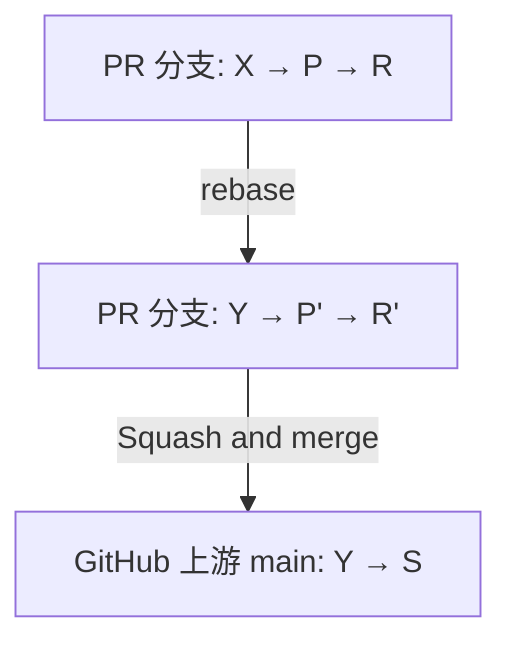
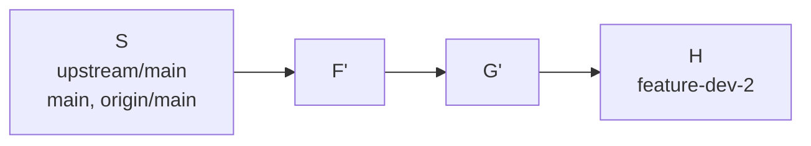

# Git 分支开发与 PR 实践指南

通过 fork 持续开发, 将成熟改动提交到上游, 再从合入后的主线继续剩余工作. 本例使用 LLVM, 命令运行于 Bash / Git Bash.



## 分支与提交

| 位置 | 职责 |
| --- | --- |
| `upstream/main` | 本地记录的上游主线, 由 fetch 更新 |
| `origin/main` | 本地记录的 fork 主线 |
| `main` | 本地主线, 用于同步上游 |
| `feature-dev-1` | 持续开发, 保存 D, E, F, G |
| `feature-a-pr` | 本轮 PR, 包含 D, E 的改动与 review 修正 |
| `feature-dev-2` | 从合入后的主线迁移 F, G, 再继续 H |

C 是开发起点. D, E 属于本轮功能; F, G, H 属于后续工作. P 是 D, E 整理后的提交, R 是 review 修正, S 是 PR squash 合入后的提交. X, Y 是上游新增提交; `'` 表示重写后的提交 ID.

`commit` 保存本地历史, `push` 更新 fork, PR 合并才进入上游.

**分支历史**: `main` 与 `origin/main` 在步骤 6 从 C 同步到 S.

```text
3-4. 提取 PR 与 review 后
C──X                      upstream/main
│  └──P──R                feature-a-pr
└──D──E──F──G             feature-dev-1

5. Rebase 后, 合入前
C──X──Y                   upstream/main
│     └──P'──R'           feature-a-pr
└──D──E──F──G             feature-dev-1

6. 同步主线并迁移后
C──X──Y──S                main, origin/main, upstream/main
│     │  └──F'──G'──H     feature-dev-2
│     └──P'──R'           feature-a-pr
└──D──E──F──G             feature-dev-1
```

<a id="step-1"></a>

## 1. 准备仓库

在 GitHub 上 fork [llvm/llvm-project](https://github.com/llvm/llvm-project). 已有 clone 时直接检查远端配置.

```bash
mkdir -p ~/work
cd ~/work
# 将 LeisureGensoul 替换为自己的 GitHub 账号.
git clone https://github.com/LeisureGensoul/llvm-project.git
cd llvm-project

# upstream 尚不存在时添加.
git remote add upstream https://github.com/llvm/llvm-project.git
git remote -v
```

结果: `origin` 指向自己的 fork, `upstream` 指向上游. 后续命令都在此仓库中执行.

首次提交前配置身份, push 前完成 [GitHub 认证](https://docs.github.com/en/authentication/keeping-your-account-and-data-secure/about-authentication-to-github):

```bash
# 替换为自己的提交身份; 已配置时跳过.
git config user.name "Example Contributor"
git config user.email "contributor@example.com"
```

**切换与迁移前保存当前改动, 保持工作区干净**. 下文文件路径与提交 ID 均为示例, 按实际修改替换. 构建, 格式化与测试遵循 [LLVM 贡献指南](https://llvm.org/docs/Contributing.html).


<a id="step-2"></a>

## 2. 创建开发分支

先同步主线, 再建立开发起点 C:

```bash
git fetch upstream main
git switch main
git merge --ff-only upstream/main
git push origin main
git switch -c feature-dev-1
```

分别完成 D, E, F 的修改和测试, 每次只提交对应改动:

```bash
# 替换为本次修改的文件.
git add src/feature.cpp tests/feature_test.cpp
git commit -m "Describe the change"

# 首次推送设置跟踪分支.
git push -u origin feature-dev-1
```

后续使用 `git push origin feature-dev-1`. 上游同步与本地开发各自推进, 每次提交前不必重新建立基线.



<a id="step-3"></a>

## 3. 提取成熟改动

D, E 已完成, F 继续留在开发分支. 先查看提交, 再从最新上游 X 创建 PR 分支:

```bash
git log --oneline -10 feature-dev-1
git fetch upstream main
git switch -c feature-a-pr upstream/main
# 替换为 D, E 的实际 ID, 按依赖顺序排列.
git cherry-pick a1b2c3d b2c3d4e
```

[Cherry-pick](https://git-scm.com/docs/git-cherry-pick) 将选中改动应用到当前分支并创建新提交. 此时 PR 分支包含 D, E 的改动, 开发分支仍保留 F.

LLVM 的首次 PR 通常采用一个完整提交. 将刚复制的 D, E 整理成 P:

```bash
git rebase -i upstream/main
```

编辑器中第一行保留 `pick`, 第二行改为 `fixup`; 提交说明需要合并时用 `squash`. 这里只整理 PR 分支, 开发分支上的 D, E 保持原样.

检查最终改动, 完成相应测试后推送:

```bash
git diff --check upstream/main...HEAD
git diff upstream/main...HEAD
git push -u origin feature-a-pr
```



<a id="step-4"></a>

## 4. 创建 PR 并处理 review

在 GitHub 创建 [来自 fork 的 PR](https://docs.github.com/en/pull-requests/how-tos/create-pull-requests/creating-a-pull-request-from-a-fork):

| 设置 | 取值 |
| --- | --- |
| Base repository / branch | `llvm/llvm-project` / `main` |
| Head repository / branch | 自己的 fork / `feature-a-pr` |

描述说明**问题, 改动与验证**. 确认 Files changed 仅包含本轮功能. 未准备好时使用 Draft, 完成后转为 Ready for review.

Reviewer 可从相关代码历史或维护者列表中寻找. 查看 Checks, 在修正后回复对应评论, 说明处理结果.

Review 修正 R 在 PR 分支追加提交:

```bash
git switch feature-a-pr
# 修改并测试后, 替换为实际文件.
git add src/feature.cpp tests/feature_test.cpp
git commit -m "Address review comments"
git push origin feature-a-pr
```

**Push 会更新原 PR**. 审核期间追加提交便于保留评论上下文, 见 [LLVM review 流程](https://llvm.org/docs/GitHub.html#updating-pull-requests).

本例的 G 不依赖 R. 回到开发分支, 在 F 的基础上继续开发并提交 G:

```bash
git switch feature-dev-1
# 完成 G 并测试后, 替换为实际文件.
git add src/feature.cpp tests/feature_test.cpp
git commit -m "Continue development during review"
git push origin feature-dev-1
```



若后续改动依赖 R, 开发前先将其 cherry-pick 到开发分支; 合入后迁移时跳过这份修正.

<a id="step-5"></a>

## 5. 更新基线并合入

假设上游推进到 Y. PR 获得批准后, 更新基线并重新测试:

```bash
git switch feature-a-pr
git fetch upstream main
git rebase upstream/main

# 解决冲突并重新测试后, 更新个人 PR 分支.
git push --force-with-lease origin feature-a-pr
```

Rebase 将 P, R 重放到 Y, 生成 P', R'. [`--force-with-lease`](https://git-scm.com/docs/git-push) 用于更新已重写的远端分支; 被拒绝时先核对远端变化.

确认最终 diff, CI 与项目要求的审核状态, 再按 [LLVM 合入规则](https://llvm.org/docs/GitHub.html#landing-your-change) 使用 Squash and merge. 没有合入权限时由 reviewer 或维护者操作.

结果: P', R' 合并为上游提交 S. **页面显示 Merged 后再迁移后续工作**.



<a id="step-6"></a>

## 6. 从新主线继续开发

查看旧分支中尚未合入的 F, G:

```bash
git switch feature-dev-1
git status
git log --oneline -10
```

从已包含 S 的主线创建下一轮开发分支, 只迁移 F, G:

```bash
git fetch upstream main
git switch main
git merge --ff-only upstream/main
git push origin main
git switch -c feature-dev-2

# 替换为 F, G 的实际 ID.
git cherry-pick c3d4e5f d4e5f6a
```

新分支已从 S 获得本轮功能与 review 修正. 核对迁移结果并测试:

```bash
git log --oneline main..HEAD
git diff main...HEAD
```

然后继续 H, 提交并推送:

```bash
# 完成 H 并测试后, 替换为实际文件.
git add src/feature.cpp tests/feature_test.cpp
git commit -m "Continue feature two"
git push -u origin feature-dev-2
```



如果旧提交混合了已合入与未合入的内容, 先整理出剩余改动再迁移. 迁移确认后可在 GitHub 删除已完成的 PR 分支, 旧开发分支按需保留.

## 冲突处理

`git status` 显示冲突文件. 修正内容并暂存后, 根据当前操作继续或取消:

```bash
# 替换为已解决冲突的实际文件.
git add src/feature.cpp
```

| 操作 | 继续 | 取消 |
| --- | --- | --- |
| Cherry-pick | `git cherry-pick --continue` | `git cherry-pick --abort` |
| Rebase | `git rebase --continue` | `git rebase --abort` |

`--abort` 返回本次操作开始前的状态. 完成后重新核对 diff 与测试结果.
