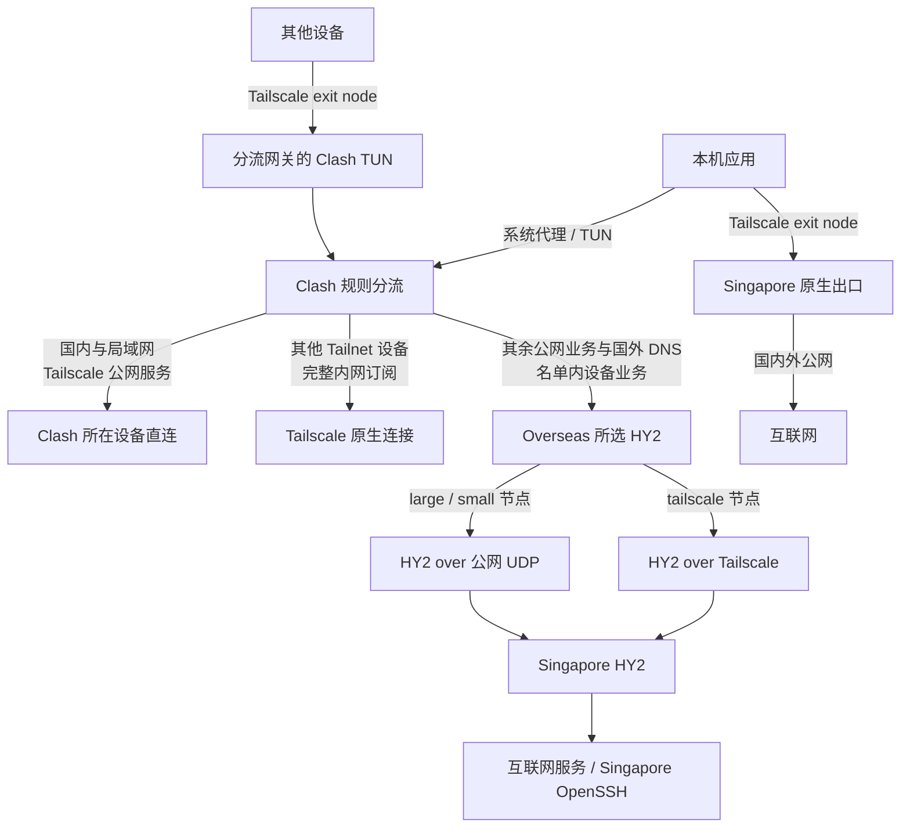

# 网络设置

## 策略总览

## Tailscale 基础网络

Tailscale 通过设备身份和访问策略连接个人设备与服务器, 提供设备互联, SSH 和 exit node.

- 设备互联: 使用 Tailscale 地址或 MagicDNS 名称.
- 远程管理: 原生连接使用 Tailscale SSH, 经 HY2 的 SSH 使用 OpenSSH 私钥登录.
- 互联网出口: exit node 使用 Tailscale 原生 WireGuard 通道把公网流量送到出口设备.
- 内网订阅: Tailscale Serve 提供全部 HY2 节点与分享信息.

## HY2 代理与授权

同一个 HY2 服务提供 Tailnet 和公网接入. `tailscale` 仅允许 Tailnet 来源, large 和 small 提供有期限和额度的公网代理.

内网配置内置 1 个 tailscale 和 4 个 large, 四个 provider 提供 16 个 small. 每个 provider 经对应 large 更新. 刷新和到期处理见 [订阅更新](hy2/setup.md#更新与分享).

large-token 返回自身和四个下级, small-token 仅返回自身.

Clash 按规则分流: 国内, 局域网与 Tailscale 公网服务直连; 名单内的 Tailnet 设备, 其余互联网业务和国外 DNS 使用所选 HY2. 系统代理覆盖遵循代理设置的应用. TUN 接管路由内的 TCP/UDP 流量.

选择 `tailscale` 节点时由 Tailscale 承载 HY2, 选择 large 或 small 时使用公网 UDP.

分流网关作为 exit node 接收其他设备的流量, 交由 Clash TUN 分流. 操作见 [共享分流](hy2/setup.md#通过-exit-node-共享分流).

设备分流集中在 `hy2_devices`, 当前只有 Singapore. 它的公网 IPv4, Tailnet 地址和名称均可用于 HY2 承载的 SSH, VS Code 和 SFTP. 其他 Tailnet 设备与完整内网订阅保持原生连接. 操作见 [HY2 部署](hy2/setup.md#客户端使用).

- 认证: 订阅 token 与 HY2 密码分别签发. 服务器按授权身份检查期限, 来源和额度.
- 生命周期: large 每周换代, small 每天换代, 无重叠期. 到期拒绝新认证并清理旧会话.
- 分发: 内网通过 Tailscale Serve, 公网通过 HTTPS token 路径. 公网不提供完整内网配置.
- 加密: 内外 HY2 正常校验可信 IP 证书, Certbot 自动续期.
- 隔离: 对服务器自身, HY2 仅允许访问 OpenSSH 和公网 HTTPS 订阅. 其他私网及元数据地址拒绝访问. 服务使用专用账号和 systemd 隔离.

## 文件职责

| 文件 | 职责 |
| --- | --- |
| [Tailscale 部署](tailscale/setup.md) | 设备注册, SSH 和出口转发 |
| [HY2 部署](hy2/setup.md) | 双入口, 分层订阅, 配额和客户端操作 |
| [subscriptions.py](hy2/subscriptions.py) | 授权状态, 订阅范围, 认证, 换代与会话撤销 |
| [build-config.py](hy2/build-config.py) | 共用客户端配置生成与快照导出 |
| [Tailscale 启动参数](tailscale/files/etc/default/tailscaled) | 传输端口 |
| [出口转发](tailscale/files/etc/sysctl.d/99-tailscale.conf) | IPv4 和 IPv6 转发 |
| [UDP 缓冲区](hy2/files/etc/sysctl.d/99-hy2-udp-buffers.conf) | UDP 收发缓冲区上限 |
| [HY2 配置](hy2/files/etc/hysteria/config.yaml) | 监听, TLS, 认证回调, Gecko, 统计与出站限制 |
| [授权配置](hy2/files/etc/hy2-subscriptions/config.yaml) | 地址, 设备分流, 状态位置和额度 |
| [Caddy 配置](hy2/files/etc/caddy/Caddyfile) | HTTPS token 入口和证书验证路径 |
| [HY2 服务](hy2/files/etc/systemd/system/hysteria.service) | 代理进程, 依赖与隔离 |
| [授权服务](hy2/files/etc/systemd/system/hy2-subscriptions.service) | 本机订阅与认证进程 |
| [Caddy 服务](hy2/files/etc/systemd/system/caddy.service) | HTTPS 入口进程 |
| [Tailnet 入站规则](hy2/files/etc/nftables.d/hysteria.nft) | HY2 的 Tailnet 地址入口限制 |
| [规则加载服务](hy2/files/etc/systemd/system/hysteria-firewall.service) | 加载入站规则 |
| [Tailscale MTU](hy2/files/etc/systemd/system/tailscaled.service.d/40-mtu.conf) | Tailnet HY2 的隧道 MTU |
| [证书续期服务](hy2/files/etc/systemd/system/hy2-certificate.service) | 执行 Certbot 续期 |
| [证书续期定时器](hy2/files/etc/systemd/system/hy2-certificate.timer) | 每 6 小时检查续期 |
| [证书发布脚本](hy2/files/usr/local/lib/hysteria/deploy-certificate.sh) | 原子替换证书文件并重新加载 HTTPS 入口 |

各目录的 `files` 对应服务器绝对路径. 真实授权状态, 凭据和证书位于仓库外, 实际数据集中在 `/data/network`.

传输实测对照见[传输说明](transport.md).
