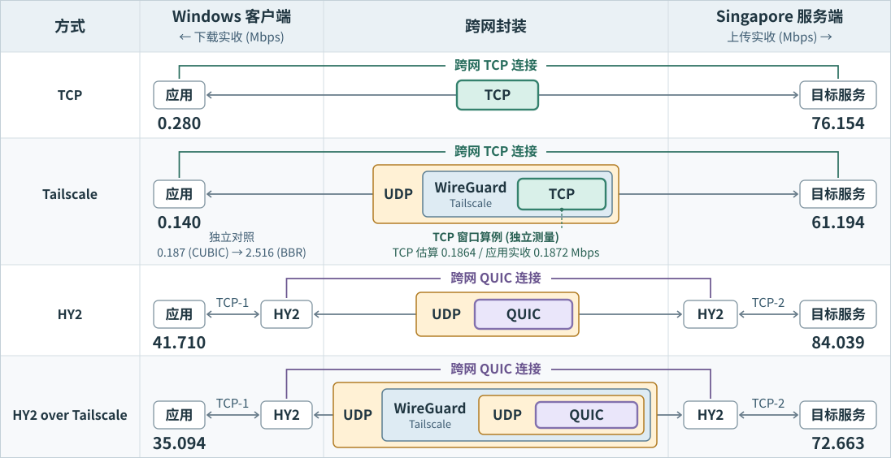

# 网络速率分析

分析[网络设置](main.md)中四种传输策略的上传与下载速率.

## 传输路径与实测速率



嵌套框从外向内表示协议封装 (省略 IP 头).

- **TCP / Tailscale** 跨网 [TCP 连接](https://www.rfc-editor.org/rfc/rfc9293.html#section-2.2)的端点是两台主机的 TCP 栈. 经 Tailscale 时, [WireGuard](https://www.wireguard.com/protocol/) 加密内层 IP 包, 再由 UDP 承载.
- **HY2 / HY2 over Tailscale** 两个 HY2 代理建立跨网 QUIC 连接, 用 [QUIC 流](https://www.rfc-editor.org/rfc/rfc9000.html#section-2)传送应用字节. 客户端的 `TCP-1` 和服务端的 `TCP-2` 是两条独立的本机 TCP 连接.

### 跨网连接的职责

传送可靠字节流时, TCP 和 QUIC 共有三项职责.

- **可靠有序交付** 接收端确认已收数据 (ACK), 发送端补发缺失数据. 同一条流内的字节按序交付.
- **流量控制** 发送量受接收端通告的 [TCP 接收窗口](https://www.rfc-editor.org/rfc/rfc9293.html#section-3.8.6)或 [QUIC 的流级与连接级额度](https://www.rfc-editor.org/rfc/rfc9000.html#section-4.1)限制.
- **拥塞控制** [TCP](https://www.rfc-editor.org/rfc/rfc5681.html#section-3) 和 [QUIC](https://www.rfc-editor.org/rfc/rfc9002.html) 的发送端根据路径反馈调节发送速率.

## 用窗口解释 TCP 下载速率

- **`cwnd`** 发送端的[拥塞窗口](https://www.rfc-editor.org/rfc/rfc5681.html#section-2), 限制已发出但尚未确认的数据量. 下载时由服务器维护.
- **`rwnd`** 接收窗口, 下载时由 Windows 随 ACK 通告.
- **RTT** 同一条 TCP 连接上, 从发送数据到收到确认的往返时延.
- **MSS** 单个 TCP 段最多携带的数据字节数.

在途数据受较小的窗口限制. 若应用持续供数且每个 RTT 用满窗口, 可按下式估算速率.

```text
cwnd (B) = cwnd (段) × MSS (B)
W (B) = min(cwnd, rwnd)
窗口速率 (Mbps) ≈ W (B) × 8 / RTT (s) / 1,000,000
```

**TCP** 实际实验的算例 (窗口和 RTT 取中位数)

- `cwnd` 2 段 × 1240 B (MSS) = 2480 B.
- `rwnd` 65280 B, 大于 `cwnd`.
- `RTT` 106.438 ms.

```text
2 × 1240 × 8 / 0.106438 / 1,000,000 ≈ 0.1864 Mbps
```

实测 0.1872 Mbps, 与估算接近. 实测窗口为 2 段, 按 100 ms RTT 估算, 维持 30 Mbps 约需 303 段.

## 分析和探索

分析实测上下行速率差异, 判断可能原因.

### 公网路径

实测双向路径如下.

| 方向 | 可见网络 |
| --- | --- |
| 上传 | CERNET → [Arelion](https://stat.ripe.net/data/network-info/data.json?resource=62.115.139.234) → Leaseweb |
| 下载 | Leaseweb → [CMI](https://stat.ripe.net/data/network-info/data.json?resource=223.120.3.86) → CERNET |

按往返路径是否相同, 公网路由分为两种.

- **对称路由** 往返路径相同, 排队和限速仍可因方向而异.
  - 两向的可用带宽, 丢包和发送端的拥塞控制相当时, 速率通常接近.
- **[非对称路由](https://www.rfc-editor.org/rfc/rfc7679.html#section-1.1)** 往返路径不同, 拥塞或丢包可能集中在一个方向.
  - 若下行更拥塞, 下载数据会变慢, [上传数据的 ACK 也可能更晚返回](https://www.rfc-editor.org/rfc/rfc3449.html#section-3).

### 传输情况

| 双端观测 | 上传 (Windows → Singapore) | 下载 (Singapore → Windows) |
| --- | ---: | ---: |
| 外层 UDP 丢包率 | 0% | 15.5% |
| 内层 TCP 字节重复率 | 0.044% | 21.7% |

上传时, TCP 很少需要补传. 下载时, Windows 把已收到的数据范围报告给 Singapore. 后续数据已到, 中间一段却迟迟未被确认, 服务器可据此推断丢包并补传.

> **TCP 补传** 即使只缺一段, [累计 ACK](https://www.rfc-editor.org/rfc/rfc2018.html#section-3) 也无法越过缺口. 补传填上缺口后, 累计 ACK 才前移.
>
> **拥塞信号** TCP默认采用的[CUBIC](https://www.rfc-editor.org/rfc/rfc9438.html#section-4.6) 把发送端判定的丢包视为拥塞信号, 在进入丢包恢复时缩小 `cwnd`. **若丢包反复出现, 窗口难以恢复, 每次往返能发送的新数据也更少**.


More : 表现更好的HY2 拥塞控制采用[默认的 BBR](https://v2.hysteria.network/docs/advanced/Full-Server-Config/#congestion).

可以进一步探索该拥塞控制策略的影响.
> **TCP 对照** 下载从 0.187 Mbps (CUBIC) 升至 2.516 Mbps (BBR), 有所提升但差距仍然明显. (不排除受到其他设置的影响) \
> 基于此, 我的判断是, HY2 - QUIC 额外的跨网确认和[丢包恢复](https://www.rfc-editor.org/rfc/rfc9002.html#section-6)可能更适合这条链路.
